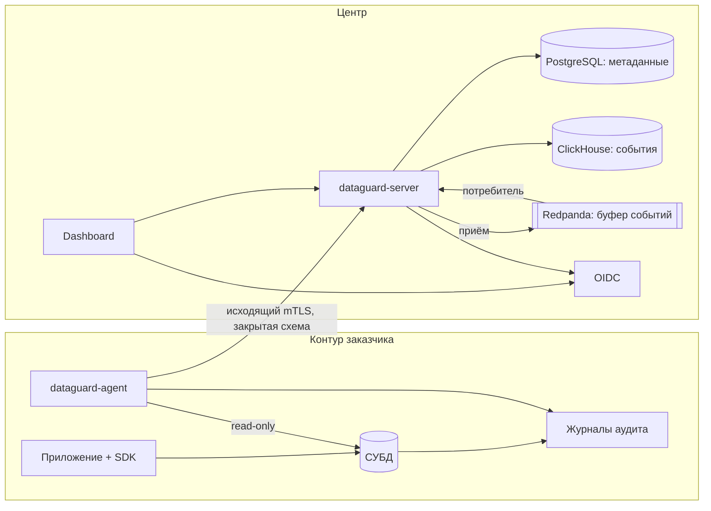

# Архитектура DataGuard

Платформа обнаруживает чувствительные данные в СУБД, классифицирует их и показывает, кто к ним обращается. Исходные значения остаются в контуре заказчика.

Документ описывает целевое устройство MVP. Что уже реализовано, видно в разделе «Состояние».

## Компоненты

Логические плоскости спецификации совпадают с пакетами, а не с отдельными сервисами. Бинарников два: `dataguard-agent` и `dataguard-server` с подкомандами `serve`, `migrate`, `pki-init`. `serve` поднимает публичный REST, mTLS-порт агентов и потребителя брокера; отдельный ingest-процесс появится, только если его потребует нагрузка. Режимы SaaS и on-premise отличаются только местом запуска `dataguard-server`.

Каждая часть работает в контейнере (ADR-0005):

| Контейнер | Образ | Что делает |
|---|---|---|
| `pki-init` | `dataguard/server` | Выпускает CA, сертификат сервера и ключ политик, если их ещё нет; кладёт сертификат CA в том для агентов |
| `migrate` | `dataguard/server` | Миграции PostgreSQL и ClickHouse, топик и учётная запись сервера в брокере |
| `server` | `dataguard/server` | REST, mTLS-порт агентов, Dashboard, потребитель брокера и порт метрик |
| `agent` | `dataguard/agent` | Discovery, сбор аудита и, если включён, порт метрик |
| `browser-check` | `dataguard/browser-check` | Проверка Dashboard в браузере, только для тестов |

## Модули

| Пакет | Ответственность | Не должен |
|---|---|---|
| `api/proto`, `api/openapi` | Контракты | Содержать логику |
| `internal/core/*` | Бизнес-логика и порты | Знать о СУБД, транспорте, хранилищах |
| `internal/connector/*` | Адаптеры СУБД | Обращаться к центру |
| `internal/classifier` | Детекторы, confidence | Знать, откуда пришли значения |
| `internal/query` | Разбор запросов, разрешение объектов | Выпускать литералы наружу |
| `internal/agent/*` | Runtime, очередь, сборщики, egress | Отправлять что-либо мимо Guard |
| `internal/server/*` | RPC, REST, ingest, хранилища | Принимать tenant из тела запроса |
| `internal/platform/*` | safelog, safeerr, pki, tenancy, metrics | Зависеть от бизнес-логики |

Запреты импортов проверяет `depguard` в `.golangci.yml`.

## Потоки

**Источник.** Администратор описывает источник в Dashboard, браузер запечатывает пароль ключом выбранного агента → центр сохраняет описание и шифротекст, увеличивает версию списка агента → агент видит новую версию в ответе на heartbeat, забирает подписанный список (`GetSources`) → сверяет цели с локальным списком разрешённых, открывает пароль → подключается и сообщает версию СУБД и возможности (`ReportSources`).

**Сканирование.** Оператор создаёт задание → агент забирает его (`PullJobs`) → читает каталог и выборки → классифицирует в памяти → проверка Guard → `SubmitScanResult` → реестр в PostgreSQL.

**Аудит.** Сборщик читает журнал → разбор и разрешение объектов в памяти → очищенное событие и позиция журнала одной транзакцией пишутся в очередь → отправка → приём проверяет и проставляет классификацию → запись в Redpanda → подтверждение агенту → удаление из очереди агента. Потребитель в каждом экземпляре сервера читает топик → отсеивает дубли → пишет в ClickHouse → фиксирует смещение (ADR-0009).

Гарантия доставки: at-least-once на каждом шаге. Дубль отсеивается при записи в ClickHouse: детерминированный `event_id` и время события ищутся по первичному ключу, запись событий одного агента идёт под его блокировкой (ADR-0007).

## Отказы

Каждый отказ виден в метриках (ADR-0008). Префикс `dataguard_agent_` у метрик агента опущен.

| Отказ | Поведение | Метрика |
|---|---|---|
| Брокер недоступен | Приём отвечает «недоступно», агент копит события, как при недоступном центре | `center_requests_total{procedure="SubmitEvents",code="unavailable"}` |
| ClickHouse недоступен | Приём продолжает подтверждать, события ждут в топике до срока хранения, потребитель перечитывает с последнего смещения | На сервере `dataguard_server_consumer_lag_records` растёт, `dataguard_server_consumer_restarts_total` растёт |
| Центр недоступен | Агент копит события, повторяет с exponential backoff | `center_requests_total{code="unavailable"}` растёт, `center_last_success_timestamp_seconds` стоит, `queue_pending_events` растёт |
| Очередь заполнена | Позиция журнала не движется, записи ждут в журнале СУБД, источник в состоянии `DEGRADED`. Если журнал ротируется раньше, создаётся `AUDIT_GAP` с причиной `QUEUE_FULL` | `queue_pending_bytes` у `queue_capacity_bytes`, `audit_source_reason{reason="QUEUE_FULL"}`, `audit_gaps_total{reason="GAP_REASON_QUEUE_FULL"}` |
| `kill -9` агента | Позиция и события согласованы; после старта чтение продолжается | `process_start_time_seconds` сменился, `events_delivered_total` растёт после старта |
| Журнал ротирован раньше чтения | `AUDIT_GAP` с причиной `LOG_ROTATED` | `audit_gaps_total{reason="GAP_REASON_LOG_ROTATED"}` |
| Запись журнала не разобрана | Счётчик, `AUDIT_GAP` с `UNPARSEABLE_RECORDS` | `audit_lost_events_total{reason="GAP_REASON_UNPARSEABLE_RECORDS"}` |
| Источник недоступен | `AuditSourceHealth = UNAVAILABLE` | `audit_source_state{state="AUDIT_SOURCE_STATE_UNAVAILABLE"} 1`, `audit_position_age_seconds` растёт |
| Часовой пояс журнала неизвестен | Журнал не читается, позиция не движется, источник в состоянии `DEGRADED` с причиной `LOG_TIME_ZONE_UNKNOWN`. Пояс берётся у СУБД: `log_timezone` у PostgreSQL, системный пояс у MariaDB | `audit_source_reason{reason="LOG_TIME_ZONE_UNKNOWN"}` |
| Агент не открыл источник из списка центра: цель не разрешена, пароль не открылся | Агент не подключается и сообщает код центру | `source_refused{code="TARGET_NOT_ALLOWED"}` и другие коды |
| Политика или список источников не прошли проверку | Агент работает по последним принятым | `center_documents_rejected_total` |

На сервере повторная доставка видна как `dataguard_server_events_ingested_total{result="duplicate"}`, задержка доставки — как `dataguard_server_event_delivery_delay_seconds`.

## Решения

Архитектурные решения — в `docs/adr/`. Смежные документы: `DATA_MODEL.md`, `EVENT_SCHEMA.md`, `CONNECTOR_SPEC.md`, `SECURITY_MODEL.md`. Что отложено после MVP — в `ROADMAP.md`.

## Состояние

| Этап | Содержание | Статус |
|---|---|---|
| 0 | Контракты, Egress Guard, инструменты, стенд | Готово |
| 1 | Platform Core: арендаторы, агенты, mTLS, RLS, RBAC, подписанные политики | Готово; вход через реальный OIDC проверяется на этапе 5 |
| 2 | Discovery, Classification: 4 СУБД, детекторы, реестр, задания | Готово |
| 3 | Audit Collection: 4 журнала, анализ запросов, очередь, контекст приложения | Готово |
| 4 | Ingest, ClickHouse, отчёты, покрытие аудита | Готово |
| 5 | Dashboard: 6 разделов, OIDC с PKCE, светлая и тёмная темы | Готово, проверено в браузере |
| 6 | Приёмка: критерии §14.2, нагрузка, ревью | Готово, см. `ACCEPTANCE.md` |
| — | Контейнеры для каждой части, сквозной тест на них | Готово |
| — | Источники создаются в центре, пароль запечатан ключом агента (ADR-0006) | Готово, проверено в браузере |
| — | Основа, `ROADMAP.md` этап 0: дедупликация при приёме, ключ по времени, агрегат отчётов, метрики, брокер, CI, замеры агента, подсказки к отказам (ADR-0007–0009) | Готово: все критерии этапа измерены, достигнуты и проверяются тестами |
| — | Единое рабочее пространство (ADR-0010): интерфейс по разрешениям, страницы объектов, фильтры в адресе | Готово, проверено в браузере; поиск, представления, избранное и виджеты — `ROADMAP.md`, этап 2 |
